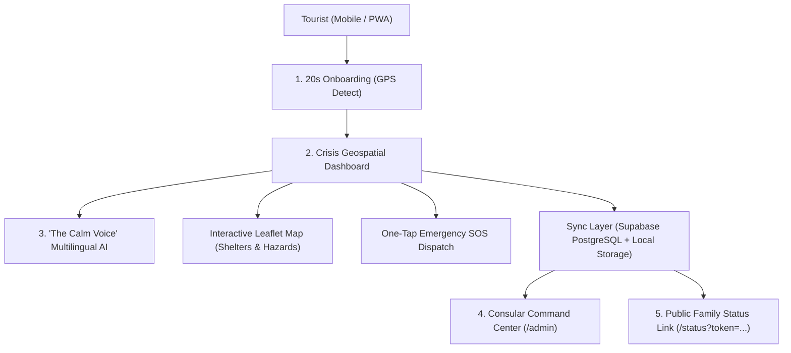

# SafePass — Autonomous Tourist Crisis Triage & Diplomatic Bridge

> **IIITDM Kancheepuram 24-Hour Web Development Hackathon 2026**  
> **Track: TravelTech** — *Real-Time Crisis Communication for Tourists During Extreme Weather Events*

[](https://vitejs.dev/)
[](https://react.dev/)
[](https://www.typescriptlang.org/)
[](https://tailwindcss.com/)
[](https://leafletjs.com/)
[](https://supabase.com/)

---

## 📌 Problem Statement & Context

When localized extreme weather catastrophes occur — such as severe cyclones, storm surges, or flash floods along coastal regions (e.g., Chennai, Kancheepuram, Mahabalipuram) — international tourists are acutely vulnerable:
- **Language Barriers**: Official alerts and emergency broadcasts are issued in regional languages and rarely localized.
- **Unverified Rumors & Panic**: Travelers rely on chaotic social media speculation, wander into active inundation zones, or become stranded.
- **Disconnected Families & Embassies**: Foreign consulates have no real-time way to account for their citizens, and families back home panic without verified information.

---

## 💡 The Solution: SafePass

**SafePass** transforms crisis response from passive weather dashboards into an **active, empathetic, and bidirectional crisis triage platform**:

### Key Innovations:
1. **"The Calm Voice" (Multilingual Crisis AI Companion)**
   - Prioritizes psychological panic reduction over raw metric overload.
   - Provides clear, localized, step-by-step guidance in English, French, Spanish, German, Japanese, and Tamil.
   - Built-in **Voice Audio Readout** (`SpeechSynthesis`) so stressed tourists can listen calmly instead of squinting at text.
   - Context-aware intelligence: recognizes road cutoff reports (e.g. East Coast Road / Buckingham Canal inundation) and directs travelers to high ground.

2. **Geospatial Crisis Navigator (Leaflet Engine)**
   - Live GPS tracking against real-time hazard layers (Red: Coastal Surge / Breach; Amber: Caution / Waterlogging).
   - Verified high-ground emergency shelters with occupancy meters, supply status (water, rations, first aid), and direct click-to-call.

3. **Consular Diplomatic Command Center (`/admin`)**
   - Real-time roster for foreign embassies and State Disaster Management Authorities (TNDMA).
   - Instant filtering by nationality (e.g. French citizens in Mahabalipuram).
   - One-click **Consular Advisory Broadcast** to transmit emergency SMS alerts to citizens in red zones.

4. **Zero-Friction Family Verification Bridge (`/status?token=...`)**
   - Generates a lightweight, public, read-only URL requiring zero app installations or account sign-ins for worried family members overseas.

5. **Zero-Fail Resilient Architecture**
   - Operates gracefully even with intermittent connectivity or unconfigured external APIs using intelligent client-side fallbacks.

---

## 🏗️ System Architecture



---

## 🚀 Getting Started Locally

### Prerequisites
- Node.js (v18 or later)
- npm or yarn

### Installation & Run

```bash
# 1. Clone the repository
git clone https://github.com/Pratyush-Singh123/SafePass.git
cd SafePass

# 2. Install dependencies
npm install --legacy-peer-deps

# 3. Start local development server
npm run dev
```

Visit `http://localhost:5173` in your browser.

### Production Build
```bash
npm run build
npm run preview
```

---

## 🌐 Live Public Deployment

- **Live Production URL**: [https://safe-pass-sand.vercel.app](https://safe-pass-sand.vercel.app)
- **GitHub Repository**: [https://github.com/Pratyush-Singh123/SafePass](https://github.com/Pratyush-Singh123/SafePass)
- **Demo Video (2–5 min)**: `[Link to YouTube / Google Drive Demo]`

---

## 👥 Hackathon Team

- **Track**: TravelTech
- **Institution**: IIITDM Kancheepuram
- **Event**: 24-Hour Web Development Hackathon 2026
